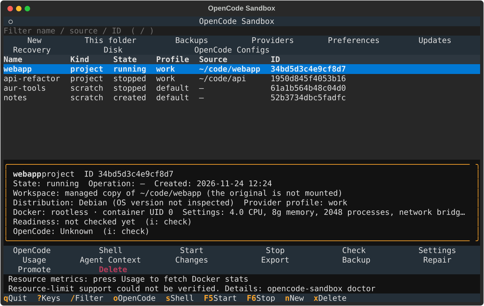

# OpenCode Sandbox

[](https://github.com/CyberFazaN/opencode-sandbox/actions/workflows/ci.yml)
[](LICENSE)

Run [OpenCode](https://github.com/anomalyco/opencode) coding agents in per-environment containers on **your own
rootless Docker daemon** by default, from a command line or a terminal dashboard. Each environment
has its own workspace, home volume, settings and credentials. With the default managed workspace,
changes reach your repository only when you transfer them, for example as a review branch.

OpenCode Sandbox is an independent open-source project. It is not affiliated with or endorsed by
the OpenCode project, and it is unrelated to other projects with similar names.

> [!IMPORTANT]
> **Beta, written by an AI agent.** The code, tests and documentation were written with
> OpenCode with Claude Opus 5.5 and GPT-6.1 Sol, with minimal human review. The evidence for its behaviour is
> the automated test suite and a test campaign on real rootless Docker, run on Arch Linux only (see [Tested environment](#tested-environment)); there has been no
> independent human security review. Expect defects, read the [security model](docs/security.md),
> and do not rely on it as your only protection against code you consider hostile.



## Is it for you?

It fits if you run OpenCode on a Linux workstation and want each project's agent in its own
container: the agent can install packages and run builds as root inside it, while your files,
keys and host stay out of reach except for what you hand over.

Consider something else if:

- you need a hard isolation boundary for untrusted code: use a virtual machine;
- you need network isolation with internet access: there is no egress filtering, only `bridge`
  (internet and local network) or `none`;
- you are on macOS or Windows: the manager needs a Linux host and a supported local Docker daemon;
- you want a general container or dev-container manager: this manages OpenCode environments
  only. Dev containers, a plain `docker run`, or OpenCode directly on your host may suit you
  better.

## Features

- **Docker backends** include rootless by default and opt-in local rootful Docker.
  [Backend settings](docs/settings.md#docker-backend)
- **Environments**: scratch (empty), project (a Git clone, optionally including local working
  changes, or a filtered copy of a folder) and
  disposable quick sessions; Debian 13, Arch Linux (AUR through `ocs-aur`) or Kali Linux rolling images, or a
  custom image.
- **Managed workspaces** by default, never your original folder; direct host workspaces only with
  explicit consent and checks (not recommended).
- **Change review**: export, bundle, inspect and stage the agent's changes as a review branch;
  host Git never uses the sandbox's Git configuration or hooks.
- **Provider profiles**: named credentials, stored with mode `0600`, mounted read-only.
- **OpenCode Configs**: copy user-maintained directories once at creation; export the global
  config to a private temporary host workspace, apply edits with drift detection, or reload a
  profile/Empty. Shared CLI/dashboard actions work with stopped environments too.
- **Settings** for CPU, memory, processes, network and published ports (`127.0.0.1` only)
  through one change plan.
- **Backups and recovery**: verified cold backups, restores into new environments, snapshots,
  and journalled operations with explicit recovery commands.
- **OpenCode versions** managed per base image and environment: dated stopped-version evidence,
  latest supported stable discovery, update policies, updates with
  automatic rollback on failure; OpenCode's self-update is off. Local version inventory remains
  available when registry discovery fails.
- **Updates inventory** in the dashboard (`v`): compact component views, local/cached-first,
  explicit version checks and full evidence in Details. Opening it does not trigger discovery.
  Optional daily GitHub/npm discovery is off by default and runs only while the dashboard is open.
  Manager checks show published full releases and local installation evidence without running
  pipx. Explicit manager updates review an exact newer published tag, close the dashboard, and
  hand off to an independent verifier/updater; there is no automatic restart or Update All.
  Environment Start/Update/Policy/Rollback/Recover reuse existing handlers with exact confirmation;
  read-only Cancel never cancels an approved mutation.
  Base Build/Rebuild and Rollback preserve copies; cached builds and explicit Refresh & Rebuild
  stay separate, without migrating existing environments or pruning Docker's build cache.
  [Current capabilities and limits](docs/dashboard.md#updates).
- **Optional Agent Context**: enabled by default per environment; OpenCode is told what the
  sandbox is (user, workspace, network, limits, operating system). The file remains available
  when automatic inclusion is off; [preview it in the dashboard](docs/dashboard.md) with `a`.
- **Direct container launches**: `ocs-opencode` safely loads the mounted provider profile and
  starts a private OpenCode server, including from scripts or a direct Docker shell.
- **Diagnostics**: `doctor` for the host, read-only `check NAME` per environment including
  measured network reachability, a live OpenCode availability probe, disk usage and conservative cleanup.

## Security in brief

- In the default **rootless** backend, container root maps to your user on the host.
  Opted-in rootful environments run as your UID and can use container-local passwordless sudo.
- The manager authenticates the selected daemon and refuses foreign, proxied and remote endpoints.
  Access to the rootful socket carries host root authority. [Security model](docs/security.md#rootful-docker)
- The default network mode `bridge` can reach the internet **and your local network**. It is
  not egress isolation. `none` disables container networking apart from its own loopback.
- The agent **can read the provider keys** mounted into its container: use scoped,
  budget-limited keys.
- A direct workspace gives the agent your folder itself, with no undo.
- Backups are not encrypted.

Details: [docs/security.md](docs/security.md).

## Tested environment

| Component | Tested |
|---|---|
| Host, real rootless Docker | Arch Linux, kernel 7.3.4: the full test campaign |
| Host, hosted CI only | Ubuntu 26.04: simulated-Docker tests, package and pipx checks on Python 3.11/3.14; rolling Arch userland tests as an unprivileged user |
| Python | Local endpoints 3.11.18 and 3.14.10; Python 3.12/3.13 are accepted but not tested separately |
| Docker | 29.10.0, rootless with slirp4netns and separate rootful checks on Debian, Arch and Kali images |
| pipx | 1.18.7 |
| Typer, Textual | 0.29.2, 8.2.8 |
| OpenCode | 2.1.4 and 2.2.0 in the real campaign; 2.3.2 in hosted image builds (npm `@opencode/cli`; 2.x only) |
| Images (inside the containers) | Debian 13 and Arch Linux in the full rootless campaign; focused Kali rolling build verification and rootful testing with Debian and Kali |

The manager is meant to run on any Linux distribution that meets the
[requirements](docs/install.md#requirements): a supported local Docker daemon, Python 3.11 or
newer with pipx, and Git. Real-world testing has been done on Arch Linux only;
other distributions are untested, so compatibility with them is expected but not guaranteed. The
image you choose for an environment is the distribution inside its container and does not depend
on your host's distribution.

Manager upgrades and base rebuilds do not change an existing container's OS. See the
[base-image guidance](docs/workspaces.md#distributions-and-images). One real model provider was
tested with OpenCode 2.x: OpenRouter (`z-ai/glm-5.3-flash`); the automated tests use a fake
OpenAI-compatible provider.

## Install

You need Linux with Python 3.11 or newer, pipx and Git; install them using your distribution's
documentation. Install the application from a release tag:

```sh
pipx install git+https://github.com/CyberFazaN/opencode-sandbox.git@v6.5.0
opencode-sandbox --version
```

To upgrade, install another tag with `--force`; `pipx upgrade` keeps the installed tag. If
`doctor` reports an older image revision, [rebuild the affected base](docs/install.md#build-the-sandbox-images)
explicitly. Existing environments are not rebuilt.
`pipx uninstall opencode-sandbox` removes the application and keeps your environments and data.

The application does not install or configure Docker. Set up your [Docker daemon](docs/install.md#prepare-docker)
and [build the base images](docs/install.md#build-the-sandbox-images) for the backend you use.

## Quick start

```sh
opencode-sandbox doctor        # host, Docker daemon identity, images
opencode-sandbox build         # the Debian base image (a few minutes)
opencode-sandbox providers set work --key OPENROUTER_API_KEY
opencode-sandbox create webapp --source ~/code/webapp --profile work
opencode-sandbox run webapp    # OpenCode in the sandbox
opencode-sandbox changes bundle webapp   # prints the BUNDLE path
opencode-sandbox changes stage BUNDLE ~/code/webapp
opencode-sandbox               # the dashboard
```

`doctor` must report `Daemon identity: verified`; otherwise it says what is missing and exits
with a code that names the problem ([docs/troubleshooting.md](docs/troubleshooting.md)). The
full walk-through: [docs/getting-started.md](docs/getting-started.md).

Git imports are **Committed only** by default. To hand the agent your in-progress work, use
`create NAME --source PATH --include-working-changes`, or select **Include working changes**
in the dashboard's New form. A status/count preview is shown; staged/unstaged changes and
non-ignored untracked files are copied without changing the source repository. Ignored untracked
files stay out; non-ignored secrets do not. See [import limits and safety](docs/workspaces.md#git-import-modes).

## External services

The manager sends no telemetry. These services are contacted:

| Service | When |
|---|---|
| GitHub, PyPI | Installation and upgrades with pipx (the source, then Typer, Textual and their dependencies) |
| Docker Hub | Base image builds (`node:24-trixie`, `archlinux:base-devel`, `kalilinux/kali-rolling`) |
| The registry of a custom image | The first start of an environment created with `create --image` |
| Debian, Arch or Kali package mirrors | Base image builds, and packages you install in an environment |
| AUR, GitHub, crates.io | The Arch image build (the AUR helper `paru` and its sources); AUR packages you install |
| npm registry | OpenCode installs and updates; version checks (`opencode check`, `opencode versions --check`) from the host; the internet probe of `check NAME` from inside the container |
| Your model provider | Whatever your provider profile and OpenCode configuration use |

OpenCode itself, and anything the agent runs, can contact other services when the network mode
is `bridge`.

## Documentation

- [Installation](docs/install.md): pipx, upgrades, uninstalling, preparing rootless Docker
- [Getting started](docs/getting-started.md)
- [Concepts](docs/concepts.md): terms, where data lives, environment variables
- [Environments and workspaces](docs/workspaces.md),
  [provider profiles](docs/providers.md), [settings](docs/settings.md)
- [OpenCode and the Agent Context](docs/opencode.md)
- [OpenCode Configs and the host export editor](docs/opencode-configs.md)
- [Backups](docs/backup.md), [change review](docs/changes.md),
  [maintenance](docs/maintenance.md)
- [Dashboard](docs/dashboard.md), [security model](docs/security.md),
  [troubleshooting](docs/troubleshooting.md)
- [Changelog](CHANGELOG.md), [roadmap and backlog](TODO.md), [contributing](CONTRIBUTING.md),
  [security policy](SECURITY.md)

`opencode-sandbox --help` and `COMMAND --help` describe every command and option.

## Support and contributing

Report bugs and ask questions in GitHub issues; include `opencode-sandbox --version` and the
output of `opencode-sandbox doctor` with keys and private paths removed. Report vulnerabilities
privately as described in [SECURITY.md](SECURITY.md). Arch Linux is the tested host; reports
from other Linux distributions are welcome and answered on a best-effort basis. Pull requests, AI-assisted or not, are
reviewed by the maintainer before they are merged; see [CONTRIBUTING.md](CONTRIBUTING.md).

## Licence

MIT; see [LICENSE](LICENSE).
