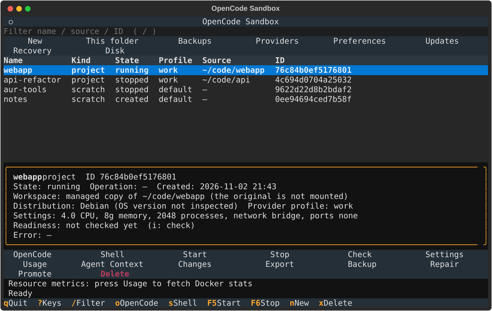

# The dashboard

```sh
opencode-sandbox        # in a terminal, without arguments
opencode-sandbox tui
```



The dashboard is usable at 80x24 and larger. Focus starts on the environment table. The top row
of buttons acts on the manager as a whole, the bottom rows on the selected environment. The
details pane shows the selected environment's state, workspace, distribution, provider profile,
settings, last readiness result and last error.

The distribution family is shown without guessing an OS version from the current base
definition. Use `status NAME` for inspected base-image provenance; new-environment choices
name the current build definitions, not an assertion that an existing container uses them.

At start the dashboard checks the Docker daemon in the background. A slow
daemon gets up to 10 seconds with a waiting notice, not a premature failure. Navigation and
quit remain available; `r` retries prerequisites and clears their old warning on success.
Automatic metadata refresh stays Docker-free. OpenCode/Shell readiness runs before suspending
the dashboard, and Agent Context observation runs in a worker. When Docker is not usable, the
status line says "Docker is not ready" and a notification gives the reason; the dashboard stays
usable for everything that does not need Docker. `opencode-sandbox doctor` shows the details.

After the daemon is verified, the same worker checks managed base-image revisions. A
"Base images need attention" notice uses the same results and commands as `doctor`. It is
advisory, not a request to replace an existing environment, and never rebuilds an image.
Press `r` for fresh dashboard results after changing images, or rerun `doctor`;
[maintenance.md](maintenance.md#base-image-definitions) explains the cases.

The same worker also reports [resource-limit support](maintenance.md#resource-limit-support).
Missing support or unavailable evidence gets an advisory notice, not an identity failure or
an automatic host repair. CPU/memory/PID capability reports do not prove kernel enforcement.

Refresh replaces each checked category's old notice rather than stacking repeated warnings.
Success clears that category; an unavailable check replaces its old warning with an unverified
result, not a claim that the problem is fixed. A category skipped because Docker is unavailable
is not marked successful. Clearing one category leaves other notices intact and reveals any
remaining advisory in the status line. New advisories do not overwrite active operation progress;
clearing advisories or readiness waits does not erase an operation's completion/recovery result.
Metadata-only refresh does not recheck or clear these advisories.

## Keys

| Key | Action | Key | Action |
|---|---|---|---|
| `Enter` / `o` | OpenCode (`run`) | `s` | Shell (`shell`) |
| `F5` / `F6` | Start / Stop | `x` | Delete (confirmation) |
| `n` | New environment (`create`; distribution, workspace mode, provider profile and integrations under "More options") | `c` | Create a project from the current folder (the confirmation shows what is copied) |
| `/` | Filter | `r` | Refresh |
| `t` | Settings (`config apply`; shows the change plan first) | `u` | Usage (`container usage`) |
| `i` | Check (`check NAME`; the details pane shows the last result) | `a` | Agent Context preview |
| `d` | Changes (`changes show`, `bundle`, `stage`, `branch-diff`) | `e` / `b` | Export changes (`changes export`) / Backup (`backup create`, stopped environment) |
| `R` | Repair | `k` | Promote a quick session to a scratch environment (`promote`) |
| `B` | Backups (`backup list`, `backup restore`) | `v` | Updates (local/cached inventory; explicit version Check) |
| `p` / `g` | Provider profiles / dashboard preferences | `F8` | Recovery Center (interrupted operations and the command that finishes each) |
| `D` | Disk (`disk usage` / `disk cleanup`; removal only after a confirmation listing every object) | `?` | All keys |
| `Esc` | Close a dialog or screen | `q` | Quit |

Dialogs default to Cancel. Dashboard keys are inactive while a sub-screen is open. Promotion to a
project, `backup restore-check`, `backup restore-rollback` and custom images are only available
in the CLI.

The read-only Agent Context preview is titled **Agent Context — NAME**. If container inspection
fails, it shows the reason and previews the configured settings with unknown base OS provenance.
In that fallback, saved guidance is **not verified**, not assumed outdated. Opening the preview
does not rewrite the saved file or start the environment; guidance is regenerated before every
OpenCode launch. Agent Context, Updates Details, readiness and cleanup-result reports are scrollable;
use Tab to reach Close, or Esc to return to the dashboard.

## Updates

`v` opens **Updates**, with three compact views: **Sandbox Manager**, **Base Images** and
**Environment OpenCode**. Press `1`, `2` or `3` to change views; use Up/Down to select an item,
`c` for **Check**, `d` or Enter for **Details**, and Esc to close. Tab reaches the primary
buttons; **Cancel check** cancels this screen's read-only checks, not an installation or another
dashboard operation. Close cancels owned checks and rejects late results. Selection survives
view changes, and returning from Details restores focus to the inventory.

Opening Updates does **not** trigger npm/GitHub discovery, execute OpenCode, start an environment or run
an image helper. Installed manager/local metadata and cached evidence appear first; bounded
Docker inspections arrive independently. Saved environment status is not treated as actual
container state. Before identity can be inspected, history is explicitly unverified; stopped
environments show dated last verification or Unknown, never their base's build label as proof.

In either OpenCode view, Check queries npm for the latest supported stable release and checks
only the selected object. A running environment gets a bounded runtime probe; a stopped one
is **not** started. An owned base image gets an explicit bounded helper probe; its build label
alone is not a runtime verification. The two views share discovery, including dated cached
success after a failed request. Source/row errors and progress remain independent. A missing
registry result means availability unknown, not "up to date"; Manual/Pinned still allow requested
comparisons without changing policy or authorizing execution.

Details discloses complete identities, observation source/time, provenance, definition revision,
errors and pending recovery, plus existing CLI guidance. Base OS/package freshness is not
assessed, and changing a base never migrates existing environments. Dashboard notices remain
owned by the dashboard but are shown as a compact notice count and full text in Updates Details,
instead of toasts covering the small-terminal controls.

**Optional daily discovery** is off by default. In Preferences (`g`), enable **Daily metadata
discovery (dashboard only)** to check npm while the dashboard runs. The dashboard considers
discovery at startup, after saving Preferences and about once a minute, but attempts each source
at most once per 24 hours, including failures and interrupted requests. It persists a claim
before contacting the source; restarting does not reset that attempt. No background service is
installed, and short CLI commands do not start unsolicited discovery. GitHub/manager discovery
is not available yet; enabling this setting does not imply a manager check.

Explicit Check may refresh sooner, but overlapping dashboard/Updates/CLI requests for the same
source and data directory share the attempt's result or failure. Both explicit and automatic
checks respect numeric/date Retry-After, even pauses longer than 24 hours. Canceling a waiting
screen does not cancel another caller's request. An interrupted request retains an incomplete
attempt rather than inventing success; explicit Check can retry when rate limits permit.

With discovery enabled, a single **Updates (N)** button indicator counts Notify-policy
environments whose dated last verification is older than the discovered release. It does not
probe Docker to calculate that count. Unknown versions, Manual/Pinned policies and pending
recovery do not generate general newer-version indicators. Explicit comparisons remain available
for all policies. The indicator is not a fresh runtime verification or install permission; its
tooltip/Details qualify cached discovery, including stale success after failure. It never creates
per-environment or repeated availability toasts, and never overwrites operation status.

Automatic discovery never starts containers or runs runtime/image probes. Disabling the preference
cancels owned automatic work and hides unsolicited availability; manual Updates remains usable.
If private scheduling storage is unsafe/unwritable, automatic checks fail closed and explain why
in Updates Details. Explicit checks can still use the bounded network path without persistence;
cross-process coalescing/throttling cannot be guaranteed without that storage. Clearing the
disposable cache resets discovery history/throttles, not installed software or recovery journals.

**Manager release discovery/installation classification and mutation buttons are not implemented here yet.**
The disabled Update button explains that limit; Details points to existing CLI operations.
Environment Start/Settings/Recovery remain available through the existing dashboard paths as
applicable. No Update All, automatic installation, temporary start/probe/stop or background
service is added. For a fresh stopped-environment version, explicitly Start from the dashboard,
then return to Updates and Check; the environment remains running.

## State

The State column is the manager's recorded state. The list updates within about 2 seconds after
the CLI changes environment metadata. A container stopped outside the manager (a plain
`docker stop`, an out-of-memory kill) still shows `running` until Repair (`R`) or the next start
or stop reconciles it.

Leaving OpenCode or a shell returns to the dashboard. Closing the terminal, or killing the
dashboard, hangs up the session inside the container
([concepts.md](concepts.md#where-things-live)).
