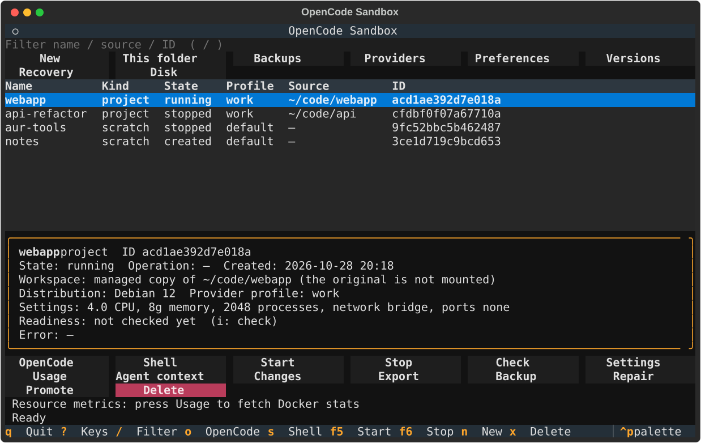

# The dashboard

```sh
opencode-sandbox        # in a terminal, without arguments
opencode-sandbox tui
```



The dashboard is usable at 80x24 and larger. Focus starts on the environment table. The top row
of buttons acts on the manager as a whole, the bottom rows on the selected environment. The
details pane shows the selected environment's state, workspace, distribution, provider profile,
settings, last readiness result and last error.

The distribution family is shown without guessing an OS version from the current base
definition. Use `status NAME` for inspected base-image provenance; new-environment choices
name the current build definitions, not an assertion that an existing container uses them.

At start the dashboard checks the Docker daemon in the background. A slow
daemon gets up to 10 seconds with a waiting notice, not a premature failure. Navigation and
quit remain available; `r` retries prerequisites and clears their old warning on success.
Automatic metadata refresh stays Docker-free. OpenCode/Shell readiness runs before suspending
the dashboard, and Agent Context observation runs in a worker. When Docker is not usable, the
status line says "Docker is not ready" and a notification gives the reason; the dashboard stays
usable for everything that does not need Docker. `opencode-sandbox doctor` shows the details.

After the daemon is verified, the same worker checks managed base-image revisions. A
"Base images need attention" notice uses the same results and commands as `doctor`. It is
advisory, not a request to replace an existing environment, and never rebuilds an image.
Rerun `doctor` for fresh results after changing images;
[maintenance.md](maintenance.md#base-image-definitions) explains the cases.

The same worker also reports [resource-limit support](maintenance.md#resource-limit-support).
Missing support or unavailable evidence gets an advisory notice, not an identity failure or
an automatic host repair. CPU/memory/PID capability reports do not prove kernel enforcement.

## Keys

| Key | Action | Key | Action |
|---|---|---|---|
| `Enter` / `o` | OpenCode (`run`) | `s` | Shell (`shell`) |
| `F5` / `F6` | Start / Stop | `x` | Delete (confirmation) |
| `n` | New environment (`create`; distribution, workspace mode, provider profile and integrations under "More options") | `c` | Create a project from the current folder (the confirmation shows what is copied) |
| `/` | Filter | `r` | Refresh |
| `t` | Settings (`config apply`; shows the change plan first) | `u` | Usage (`container usage`) |
| `i` | Check (`check NAME`; the details pane shows the last result) | `a` | Agent Context preview |
| `d` | Changes (`changes show`, `bundle`, `stage`, `branch-diff`) | `e` / `b` | Export changes (`changes export`) / Backup (`backup create`, stopped environment) |
| `R` | Repair | `k` | Promote a quick session to a scratch environment (`promote`) |
| `B` | Backups (`backup list`, `backup restore`) | `v` | OpenCode versions (`opencode versions --check`, on demand only) |
| `p` / `g` | Provider profiles / dashboard preferences | `F8` | Recovery Center (interrupted operations and the command that finishes each) |
| `D` | Disk (`disk usage` / `disk cleanup`; removal only after a confirmation listing every object) | `?` | All keys |
| `Esc` | Close a dialog or screen | `q` | Quit |

Dialogs default to Cancel. Dashboard keys are inactive while a sub-screen is open. Promotion to a
project, `backup restore-check`, `backup restore-rollback` and custom images are only available
in the CLI.

## State

The State column is the manager's recorded state. The list updates within about 2 seconds after
the CLI changes environment metadata. A container stopped outside the manager (a plain
`docker stop`, an out-of-memory kill) still shows `running` until Repair (`R`) or the next start
or stop reconciles it.

Leaving OpenCode or a shell returns to the dashboard. Closing the terminal, or killing the
dashboard, hangs up the session inside the container
([concepts.md](concepts.md#where-things-live)).
